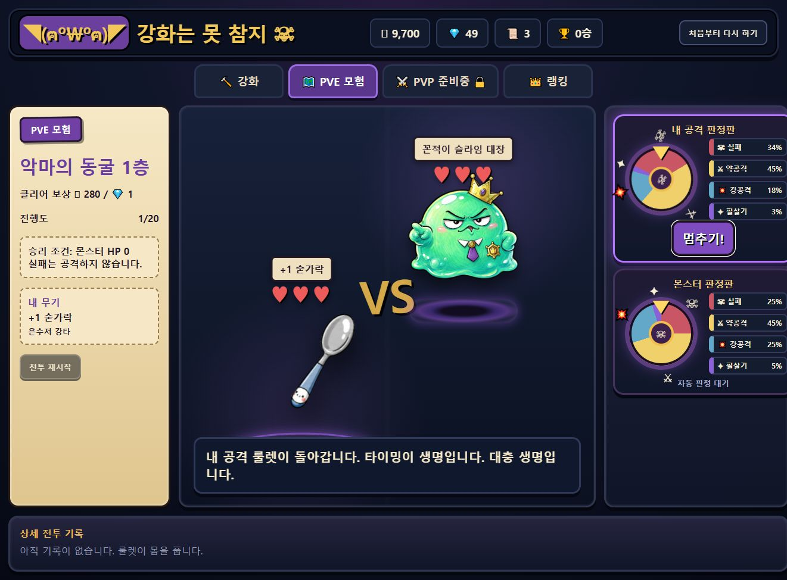

# 강화는 못 참지

> 성공 확률 앞에서 한 번 더 누르게 되는 강화 시스템과 룰렛 전투를 결합한 웹 게임입니다.


## 1. 프로젝트 소개

`강화는 못 참지`는 무기의 강화 성공·실패 리스크와 턴제 룰렛 전투를 중심으로 만든 싱글 플레이 웹 게임입니다. 강화 단계가 바뀔 때마다 무기와 확률, 비용, 실패 위험을 다시 읽어야 하고, PVE에서는 공격 판정판의 타이밍을 멈추며 몬스터를 상대합니다.

## 2. 플레이 미리보기



*몬스터와의 대결, 두 개의 룰렛 판정판, 무기·보상·진행도가 동시에 보이도록 구성한 PVE 전투 화면입니다.*

## 3. 구현한 핵심 기능

- 강화 성공률·비용·하락 위험이 단계에 따라 달라지는 강화 루프
- 무기별 공격력·이름·스프라이트와 강화 결과 피드백
- 수호 주문서, 골드, 다이아처럼 강화 판단에 영향을 주는 재화
- 플레이어와 몬스터가 각각 확률판을 사용하는 룰렛 기반 PVE 전투
- 던전 진행도, 보상, 전투 기록, 랭킹 화면과 목업 랭킹 데이터
- 전투 이펙트·부유 텍스트·스프라이트 배치로 결과를 즉시 전달하는 UI

## 4. 만들며 배우고 싶었던 것 · 습득한 것

**목표**

확률형 강화가 주는 긴장감을 숫자만이 아니라 화면 연출과 선택의 맥락으로 전달하고, 작은 게임 루프를 처음부터 끝까지 완성하고자 했습니다.

**습득**

- React 컴포넌트로 강화·전투·랭킹 화면을 분리하는 방법
- 확률 테이블과 전투 규칙을 UI에서 분리해 테스트·조정하기 쉬운 구조
- 상태 변화에 맞춰 애니메이션, 결과 메시지, 자원 표시를 연결하는 경험
- 무기·몬스터 데이터와 렌더 설정을 분리해 콘텐츠 확장성을 확보하는 방법
- 실패와 성공의 감정을 살리는 피드백 설계와 난이도 밸런싱의 기초

## 5. 기술 스택

| 영역 | 사용 기술 | 활용 |
| --- | --- | --- |
| UI | React, JavaScript | 강화, PVE, 랭킹 화면과 상태 관리 |
| Build | Vite | 로컬 개발과 정적 빌드 |
| Logic | JavaScript modules | 강화 확률, 룰렛, 전투 규칙 |
| Style | CSS3 | 게임 패널, 애니메이션, 반응형 배치 |
| Data | Local storage, Mock data | 로컬 진행 상태와 랭킹 예시 |

## 6. 구조

```text
src/components/  ─ 강화·전투·룰렛·랭킹 UI
src/data/        ─ 무기, 몬스터, 확률, 메시지 데이터
src/utils/       ─ 강화·전투·룰렛·저장 로직
src/services/    ─ 랭킹 데이터 서비스
```

## 7. 로컬 실행

```bash
npm install
npm run dev
```

개발 서버 주소는 Vite가 출력하는 로컬 URL을 사용합니다.

## 8. 검증

```bash
npm run build
```

프로덕션 빌드가 정상적으로 생성되는지 확인합니다.

## 9. 다음 개선 방향

- 실제 PVP 매칭과 서버 기반 랭킹 연동
- 강화 기록·장비 도감·던전 보상 구조 확장
- 사운드, 화면 흔들림, 연속 성공 연출로 강화의 손맛 강화

---

개발자: 정승 · 확률형 게임 루프, React 상태 관리, 전투 피드백 UX를 학습하기 위한 개인 프로젝트
